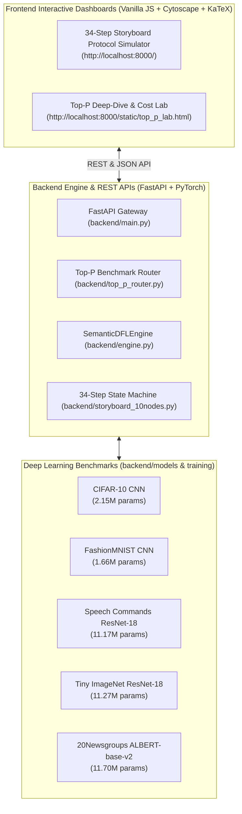
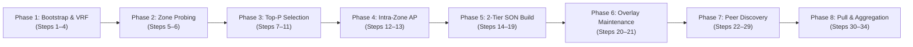

# SemanticVisual: Interactive Simulator for SemanticDFL

[](https://www.python.org/)
[](LICENSE)
[](https://fastapi.tiangolo.com/)
[](https://js.cytoscape.org/)
[](tests/)
[](SemanticFL-Final-Version.pdf)

> **SemanticVisual** is a research-grade, full-stack visualizer and distributed systems simulator built to demonstrate, benchmark, and interactively explore the **SemanticDFL** protocol from the research paper:
> 
> 📄 **"SemanticDFL: Similarity-Aware Pull-based Personalized Decentralized Federated Learning"**  
> *Dogani, Khastkhodaei, Khunjush, Laoutaris*  
> **Proceedings of the ACM on Measurement and Analysis of Computing Systems (POMACS) / ACM SIGMETRICS 2026**, Vol. 10, No. 2, Article 51.  
> 🔗 Local Paper Copy: [`SemanticFL-Final-Version.pdf`](./SemanticFL-Final-Version.pdf)

---

## 🌟 Executive Summary & Motivation

In standard **Decentralized Federated Learning (DFL)**, edge devices train local models and exchange parameters peer-to-peer without a centralized parameter server. However, real-world deployments encounter three fundamental bottlenecks:

1. **Extreme Communication Overhead:** Transmitting dense deep neural network weights (millions of FP32 parameters) across wireless or bandwidth-constrained links drains energy and stalls training.
2. **Non-IID Data Heterogeneity & Divergence:** Clients hold vastly divergent class distributions. Indiscriminate peer parameter averaging leads to catastrophic client drift and degraded local accuracy.
3. **Sybil & Coordination Attacks:** Malicious participants can spawn pseudo-identities to capture leader elections and poison aggregation clusters.

**SemanticDFL** solves these challenges through a multi-tier, similarity-aware architecture:
- 🎯 **Top-$P$ Semantic Signatures:** Nodes compress their local parameter importance into compact sparse signatures ($6P$ bytes instead of $4M$ bytes), cutting communication wire cost by **80% to 90%+** while preserving peer-to-peer cosine similarity rankings.
- 🛡️ **Sybil-Resilient VRF Leader Election:** Nodes independently compute deterministic Verifiable Random Function (VRF) hashes to elect zone initiators without central arbiters.
- 🌐 **Hierarchical 2-Tier Semantic Overlay Network (SON):** Physical networks partition into local geographic zones via bounded-TTL probing; Affinity Propagation meta-clusters similar nodes; and Tier-2 Super-Peers bridge clusters for efficient semantic routing.
- ⚖️ **Similarity-Weighted Pull-Based FedAvg:** Clients pull parameters from semantically aligned peers, weighting updates using a softmax over cosine similarity to maximize personalization and prevent drift.

**SemanticVisual** brings this entire protocol to life with real-time visual simulations, live neural network parameter inspectors, step-by-step mathematical proofs, and analytical cost calculators.

---

## 🏛️ System Architecture



---

## 🚀 Two Interactive Simulation Dashboards

SemanticVisual provides two dedicated interfaces:

### 1. The 34-Step Protocol Storyboard Simulator (`/` or `/static/index.html`)

An interactive visualizer implementing the 10-node CIFAR-10 benchmark topology:

- **Interactive Topology Graphs (Cytoscape.js):**
  - **Physical View:** 10 nodes distributed over a 2D Euclidean field with wireless communication radius ($d_{\text{limit}} = 350\text{m}$).
  - **Hierarchical Overlay View (2-Tier SON):** Dynamic tree layout visualizing Super-Peers (Tier 2), Cluster Exemplars (Tier 1), and Leaf Nodes.
- **Dual Themes:** Switch between **Academic Paper Mode** (clean publication-ready layout) and **Cyberpunk HUD Mode** (high-contrast dark operations center).
- **Step-by-Step Playback:** Play/Pause automatic walk-through, adjust simulation speeds ($0.5\times$ to $5\times$), or jump directly to any step.
- **Mathematical Formulations:** Rendered live with KaTeX LaTeX equations explaining the exact protocol mathematics of each step.
- **Real-Time Inspectors:** Inspect active node state, local CIFAR-10 class distributions (Chart.js), VRF scores, Top-$P$ signature masks, neighbor routing tables, and live communication exchange logs.



---

### 2. Top-P Deep-Dive & Cost Lab (`/static/top_p_lab.html`)

A comprehensive exploration hub focused on model parameter extraction, compression benchmarks, and analytical complexity:

1. **Top-P Benchmark Inspector:**
   - Supports 5 canonical research models: **CIFAR-10**, **FashionMNIST**, **Speech Commands**, **Tiny ImageNet**, and **20Newsgroups**.
   - Dynamic parameter inspection: View Head, Tail, and Top-$K$ absolute magnitude parameter slices mapped to exact layer boundaries.
   - Run synthetic or empirical parameter extraction with binary search trace and quantile consensus ($P_{\min}$).
   - Compare Full Dense Cosine vs. Sparse Top-$P$ Cosine ranking matrices.
2. **ResNet-18 Worked Example:**
   - Reproduces Section 3.4 and Appendix D of the paper with real numbers plugged into every formula.
   - Interactive cost calculator: Adjust parameters ($M$, $P$, $K$, network bandwidth) to instantly recalculate wire payload sizes, transmission latencies, and speedup multipliers.
3. **Paper Models & Savings Explorer:**
   - Comprehensive analytical tables comparing dense baseline vs. Top-$P$ across rounds 1, 10, 50, and 100.
   - 16 Non-IID experimental scenario benchmarks comparing convergence speed, test accuracy, and cumulative communication savings.
   - Every metric is explicitly labeled with provenance tags: `[Paper §x]`, `[Derived]`, or `[Simulator]`.
4. **Interactive Theory & FAQ:**
   - In-depth Q&A addressing Byzantine tolerance, churn resilience, boundary edge routing, and mathematical trade-offs.

---

## 📐 Protocol Lifecycle: 34 Steps in 8 Phases

| Phase | Steps | Key Operations & Mathematical Mechanisms |
|:---|:---:|:---|
| **Phase 1: Bootstrap & VRF Election** | 1–4 | Euclidean distance evaluation $d(p, q) \le d_{\text{limit}}$; independent VRF hash evaluation $\sigma_p = \text{VRF}_p(\text{seed})$; 1-hop exchange electing nodes with minimum $(\sigma_p, id_p)$ as **Initiators**. |
| **Phase 2: Geographic Zone Formation** | 5–6 | Initiators flood `PROBE` packets bounded by $R$-hop TTL ($R=2$); nodes bind to closest initiator, forming physical partitions $\mathcal{Z}_z$; boundary edges between partitions are registered. |
| **Phase 3: Top-$P$ Dimension Selection** | 7–11 | Nodes perform local binary search for $P_{\min}^i$ satisfying directional cosine similarity $\cos(\mathbf{w}_i, \text{Top-}P(\mathbf{w}_i)) \ge \theta$ ($0.70$); Initiators run $(1-q)$-quantile consensus to establish global signature dimension $P^*$. |
| **Phase 4: Intra-Zone Semantic Clustering** | 12–13 | Nodes send Top-$P$ signatures to their Initiator; Initiator runs **Affinity Propagation (AP)** clustering with preference $p = \text{median}(S)$ to elect local **Cluster Exemplars**. |
| **Phase 5: Recursive 2-Tier SON Build** | 14–19 | Initiators exchange exemplar summaries along physical boundary edges; inter-cluster AP designates **Tier-2 Super-Peers** to manage cross-zone routing catalogs. |
| **Phase 6: Overlay Maintenance & Replication** | 20–21 | Super-Peers and Exemplars replicate routing state to $r=2$ fallback peers; sparse overlay graph is finalized with average node degree $\bar{d} \approx 3.4$. |
| **Phase 7: Per-Round Semantic Search** | 22–29 | Requester submits Top-$P$ query; Exemplars and Super-Peers prune dissimilar clusters and route to top-$K$ semantically compatible peers. |
| **Phase 8: Pull & Aggregation** | 30–34 | Requester pulls dense weights only from selected $K$ peers; computes similarity weights $\alpha_j = \frac{\exp(\beta \cdot \text{sim}(i,j))}{\sum_k \exp(\beta \cdot \text{sim}(i,k))}$; performs personalized FedAvg; updates metrics. |

---

## 📊 Benchmark Models & Compression Ratios

| Benchmark Model | Dataset | Parameter Count ($M$) | Top-$P$ Dimension ($P$) | Compression Ratio | Dense Size (FP32) | Top-$P$ Size ($6P$) |
|:---|:---|:---:|:---:|:---:|:---:|:---:|
| **2-Stage CNN** | CIFAR-10 | $2,156,490$ | $215,649$ (10%) | **6.67×** | 8.23 MiB | 1.23 MiB |
| **2-Stage CNN** | FashionMNIST | $1,663,370$ | $166,337$ (10%) | **6.67×** | 6.35 MiB | 0.95 MiB |
| **ResNet-18** | Speech Commands | $11,173,962$ | $1,430,267$ (12.8%) | **5.21×** | 42.63 MiB | 8.18 MiB |
| **ResNet-18** | Tiny ImageNet | $11,271,432$ | $1,442,743$ (12.8%) | **5.21×** | 43.00 MiB | 8.25 MiB |
| **ALBERT-base-v2** | 20Newsgroups | $11,698,964$ | $1,497,467$ (12.8%) | **5.21×** | 44.63 MiB | 8.57 MiB |

---

## ⚡ Quickstart & Installation

### Prerequisites
- **Python 3.10+** (Tested on Python 3.10, 3.11, 3.12, and 3.13)
- Modern web browser (Chrome, Firefox, Safari, Edge)

### 1. Clone Repository & Install Dependencies

```bash
git clone https://github.com/khastkhodaei/SemanticVisual.git
cd SemanticVisual

# Create and activate virtual environment (optional but recommended)
python -m venv .venv
# Windows:
.venv\Scripts\activate
# Linux/macOS:
source .venv/bin/activate

# Install required dependencies
pip install -r requirements.txt
```

---

### 2. Launch the Application

SemanticVisual provides automated, one-click launcher scripts that start the server and automatically launch your default web browser once initialized:

#### On Windows:
- **Option A (One-Click):** Double-click [`start_server.bat`](./start_server.bat) or [`run_windows.bat`](./run_windows.bat).
- **Option B (PowerShell):** Run `.\start_server.ps1`
- **Option C (Command Line):**
  ```powershell
  python run.py
  ```

#### On Linux / macOS:
- **Option A (Shell Script):**
  ```bash
  chmod +x start_server.sh run_linux.sh
  ./start_server.sh
  ```
- **Option B (Command Line):**
  ```bash
  python3 run.py
  ```

#### Direct Uvicorn Launch:
```bash
python -m uvicorn backend.main:app --host 127.0.0.1 --port 8000 --reload
```

---

### 3. Application Endpoints

Once running, navigate to:

| Interface | URL | Description |
|:---|:---|:---|
| **Top-P Deep-Dive Lab** | `http://127.0.0.1:8000/static/top_p_lab.html` | Analytical cost calculator, model weight inspector, benchmark comparison, and theory FAQ. |
| **Storyboard Protocol Simulator** | `http://127.0.0.1:8000/` | Full 34-step interactive Cytoscape simulation of the 10-node CIFAR-10 network. |
| **Interactive API Documentation** | `http://127.0.0.1:8000/docs` | Swagger / OpenAPI interactive explorer for all REST endpoints. |
| **System Health Check** | `http://127.0.0.1:8000/health` | Live service health check and active session monitor. |

---

## 🧪 Testing & Verification

The codebase includes an automated test suite comprising **61 test files** and **468 tests** verifying all mathematical models, API contracts, step invariants, and UI schemas:

```bash
# Run the complete test suite
pytest

# Run tests with short traceback for fast validation
pytest -q tests/test_top_p_costs.py tests/test_top_p_cnn_ui.py

# Run step-by-step storyboard protocol tests
pytest tests/test_step*.py
```

**Verification Results:**
- ✅ **463 passed**, 5 skipped (optional external GPU fixtures), **0 failures** out of 468 items.
- Full verification of binary search bounds, AP clustering convergence, VRF leader election determinism, and layer weight flattening round-trips.

---

## 📁 Repository Structure

```text
SemanticVisual/
├── backend/
│   ├── models/                   # PyTorch architectures (CIFAR, FMNIST, Speech, TinyImageNet, ALBERT)
│   │   ├── cifar_cnn.py          # 2-Stage CIFAR-10 CNN
│   │   ├── fmnist_cnn.py         # FashionMNIST CNN
│   │   ├── speech_resnet.py      # Speech Commands ResNet-18
│   │   ├── tiny_imagenet_resnet.py # Tiny ImageNet ResNet-18
│   │   ├── news_albert.py        # 20Newsgroups ALBERT-base-v2
│   │   └── flattening.py         # Parameter flattening & lossless unflattening engine
│   ├── training/                 # Model training, checkpointing & caching scripts
│   ├── config.py                 # 10-Node CIFAR-10 canonical topology & distributions
│   ├── engine.py                 # SemanticDFLEngine core (AP, VRF, FedAvg, RGG, SON)
│   ├── main.py                   # FastAPI application & session manager
│   ├── storyboard_10nodes.py     # 34-step deterministic storyboard state machine
│   ├── top_p_costs.py            # Analytical wire sizing & transfer latency formulas
│   └── top_p_router.py           # Dedicated REST endpoints (/api/v1/toppaper)
├── frontend/
│   ├── static/
│   │   ├── vendor/               # Bundled offline libraries (Cytoscape, Dagre, Chart.js, KaTeX)
│   │   ├── app.js                # Cytoscape graph controllers & animation pipelines
│   │   ├── style.css             # Publication & Cyberpunk HUD design system
│   │   ├── top_p_faq.json        # Structured Q&A dataset with provenance tags
│   │   ├── top_p_lab.css         # Scoped styling for Top-P Lab
│   │   ├── top_p_lab.html        # Top-P Deep Dive & Cost Lab interface
│   │   └── index.html            # Static storyboard dashboard layout
│   └── templates/
│       └── index.html            # Primary template entrypoint
├── tests/                        # 61 pytest suites (468 tests covering steps 1-34 & models)
├── docs/                         # Additional documentation & issue trackers
├── AGENTS.md                     # Agent engineering workflows & development guidelines
├── CONTEXT.md                    # Formal ubiquitous domain vocabulary & invariants
├── HANDOFF.md                    # Comprehensive architectural handoff documentation
├── PAPER_COSTS.md                # Paper cost reference organized stage by stage
├── STEPS.md                      # Detailed 34-step protocol specification
├── SemanticFL-Final-Version.pdf  # The published ACM 2026 research paper
├── requirements.txt              # Production Python package requirements
├── run.py                        # Unified cross-platform application launcher
├── start_server.bat              # Windows batch launcher (auto-browser launch)
├── start_server.ps1              # Windows PowerShell launcher
├── start_server.sh               # Linux / macOS shell launcher
└── LICENSE                       # MIT Open-Source License
```

---

## 📖 Citation

If you use **SemanticVisual** or reference the **SemanticDFL** protocol in your research, please cite the paper:

```bibtex
@article{semanticdfl2026,
  author    = {Dogani, Mostafa and Khastkhodaei, Sanaz and Khunjush, Farshad and Laoutaris, Nikolaos},
  title     = {{SemanticDFL}: Similarity-Aware Pull-based Personalized Decentralized Federated Learning},
  journal   = {Proceedings of the ACM on Measurement and Analysis of Computing Systems (POMACS)},
  volume    = {10},
  number    = {2},
  articleno = {51},
  year      = {2026},
  publisher = {ACM New York, NY, USA},
  doi       = {10.1145/XXXXXX.XXXXXX}
}
```

---

## 📜 License

This project is licensed under the **MIT License** — see the [LICENSE](LICENSE) file for details.
All bundled vendor libraries (`Cytoscape.js`, `Dagre`, `Chart.js`, `KaTeX`) remain under their respective permissive open-source licenses.
